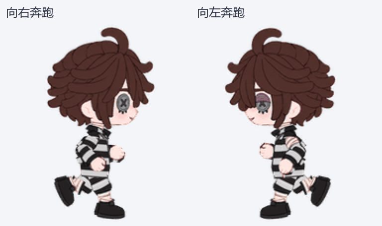
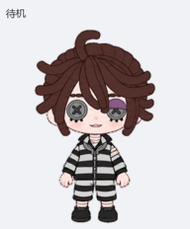

# Luca — ChatGPT Pet

[中文](README.zh-CN.md) | English

An unofficial Identity V Prisoner / Luca animated pet asset project for ChatGPT Work Pets. Includes nine animation states and sixteen look directions, with complete side-profile running in both directions.



The final atlas is [assets/luca-v2.png](assets/luca-v2.png): transparent RGBA PNG, 1536 × 2288, eight columns × eleven rows, 192 × 208 per cell. There are 57 animation frames and 16 look poses; 15 unused cells stay transparent. “v2” describes the Pets atlas format; this artwork revision is v5.

## Preview



[Idle](assets/previews/idle.gif) · [Left run](assets/previews/running-left.gif) · [Right run](assets/previews/running-right.gif) · [Wave](assets/previews/waving.gif) · [Jump](assets/previews/jumping.gif) · [Disappointed](assets/previews/failed.gif) · [Waiting](assets/previews/waiting.gif) · [Working](assets/previews/running.gif) · [Review](assets/previews/review.gif)

[Idle / run color comparison](assets/previews/idle-running-comparison.gif) · [Sixteen directions](assets/previews/look-directions.png) · [MP4 overview](assets/previews/all-states.mp4)

## Use in ChatGPT

In an environment with the Pets plugin and custom pet upload support, provide `assets/luca-v2.png` and ask the Pets workflow to validate it and create or update a custom pet. Select the pet separately if you want to activate it. This repository is the artwork and build pipeline; it does not add a new import button, client event hooks or keyword commands. Availability depends on the client and account.

The client chooses animations from work activity. **Nine included states do not imply nine user commands.** The exact mapping of the `review` row to the client's Ready state is unconfirmed. See [state meanings and triggers](docs/STATES.md).

## Rebuild

Python 3.12 was used. Run from the repository root:

```sh
python -m pip install -r requirements.txt
python scripts/rebuild.py
python scripts/verify.py
```

The build writes `build/luca-v2.png`, two eight-frame cycles, reusable layer PNGs and motion parameters. It uses the two already calibrated side-view anchors, rotates hierarchical joints and replaces only the running rows in the baseline atlas. Verification compares the rebuilt image against the shipped image pixel for pixel, checks transparency, occupied cells and asset hashes. It requires no API key or image generation service.

## Production notes

The torso, head, arms, shorts, wraps and boots all face sideways. Arm bandage placement follows anatomical sides. Each run cycle reuses fixed source textures; limb depth uses occlusion instead of alternating dark tints. Edges still change through interpolation. Existing non-running animation rows are preserved exactly.

- [Workflow, tools and evidence boundaries](docs/WORKFLOW.md)
- [State layout and trigger limitations](docs/STATES.md)
- [Source art prompt](docs/source-art-prompt.md)
- [Quality checks](qa/README.md)
- [Credits](CREDITS.md)

This is a sprite atlas project. It does not contain the reference video's Cubism model, Live2DViewerEX configuration or BongoCat package.
