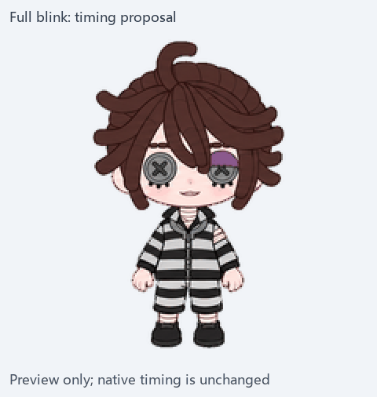

# Full blink and a natural timing proposal

[中文](BLINK.zh-CN.md)

## Installed artwork

Idle restores the previously approved fully closed eyes. Only the eye pixels in idle frame 1 change. Hair, head proportions, costume, disappointment, running and direction poses remain unchanged. One fully closed frame is retained so additional transition slots do not prolong closure.

The native client controls frame durations. The atlas upload interface has no per-frame timing parameter, so restoring the full blink does not shorten native closure. Do not claim a timing override by adding unsupported fields to `pet.json`.

## Suggested natural full blink

This is a timing proposal, not an enabled native Codex setting.

| Phase | Suggested duration | Artwork |
|---|---:|---|
| Open rest | 4–6 seconds, varied | Subtle breathing; fixed hair and head shape |
| Closing | 40 ms | Transition toward half-closed lids |
| Fully closed | 60 ms | Both eyes clearly closed |
| Opening | 80 ms | Return through half-closed lids to open |

A blink totals about 180 ms, closing faster than it opens. Avoid whole-face squashing, head resizing and hair recoloring. Applying these durations requires per-frame timing support; extra transition frames in a fixed-timing client can make blinking slower.

The preview alternates open rests of 4 and 5.2 seconds. It does not change the Codex player. See the [current idle preview](../assets/previews/idle.gif) for the native timing reference.

[Timing data](natural-blink-timing.json) is proposal data, not an install manifest. Run `python scripts/render_blink_proposal.py` to render the demonstration. No pointer tracking is included.
