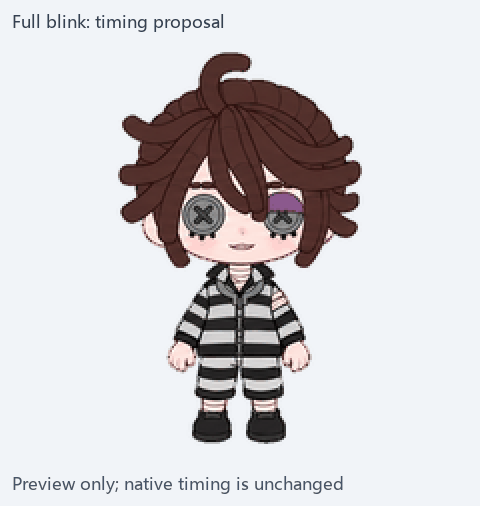

# 完整眨眼与自然节奏方案

[English](BLINK.md)

## 当前宠物

待机已恢复完整闭眼，复用原先认可的闭眼画面。仅替换待机第 1 帧的眼部像素；头型、发色、衣服、失落动作、跑步和方向姿态保持不变。仍只安排一个完整闭眼帧，避免多个闭眼过渡槽叠加成更长的停顿。

原生客户端控制图集的单帧时长。当前上传接口没有逐帧速度参数，因此恢复完整眨眼不代表原生闭眼时长已经缩短；不要添加无效的 `pet.json` 字段声称提速。

## 建议的自然全眨眼

这是制作与调节节奏的建议，不是已在 Codex 原生客户端启用的配置。

| 阶段 | 建议时长 | 画面 |
|---|---:|---|
| 睁眼休息 | 4–6 秒，轻微变化 | 保留轻微呼吸，头发和头型不变 |
| 闭合过渡 | 40 毫秒 | 从睁眼过渡到半闭眼 |
| 完整闭眼 | 60 毫秒 | 明确全闭，两眼协调 |
| 睁开过渡 | 80 毫秒 | 经半闭眼恢复睁眼 |

一次眨眼约 180 毫秒，闭合稍快、睁开稍慢。过程中不压缩整张脸，不改头部大小，不给头发重新着色。实际使用该节奏需要播放端支持逐帧时长；固定时长客户端中增加过渡帧反而可能让眨眼更慢。

预览在两次眨眼之间分别保持睁眼 4 秒和 5.2 秒，没有修改 Codex 播放器。图集实际待机效果见[当前待机预览](../assets/previews/idle.gif)。

[阶段参数](natural-blink-timing.json)仅是方案数据，不是安装配置。使用 `python scripts/render_blink_proposal.py` 可重新导出演示；不包含鼠标追踪。
